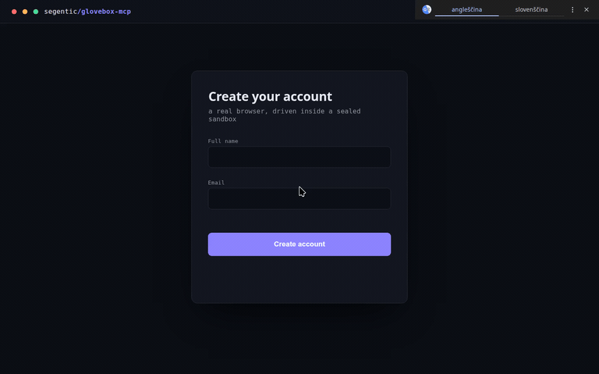

# glovebox-mcp

A **sandboxed computer-use MCP server** — let an AI agent drive a real browser and desktop apps
(mouse, keyboard, screenshots, clipboard, vision grounding), confined to a **nested X11 window** so
its input and vision never touch your real screen or the windows of your other apps.

Like a lab **glovebox**: the agent reaches in and manipulates real applications, sealed off from
your desktop. Bring the sandbox up, log into whatever sites or apps you want to automate *inside
that window*, and the agent operates only there — you can watch it live and close it instantly.

> Speaks the [Model Context Protocol](https://modelcontextprotocol.io), so it works with MCP clients
> like Claude Code. Your host can run Wayland; the sandbox gives the agent a real X server to drive.



<sub>An agent driving a real browser in the sandbox — gliding the cursor, inserting a unicode name (`Nadja Kovačič`), typing, and submitting. All confined to a nested X11 window.</sub>

## Why a nested X11 sandbox?

- Most desktop automation (xdotool, PyAutoGUI) is **X11-only**, but many modern desktops run **Wayland**.
- **Xephyr** provides a real X server *inside a single window* (`DISPLAY :1`). Everything the agent
  does — clicks, typing, screenshots — is **confined to that window**, not your real desktop.
- You stay in control: watch it live, `pkill Xephyr` to close everything.

The isolation is **display-level** (see [Safety](#safety)): the apps themselves run as your user with
your filesystem. For OS-level isolation run glovebox inside a VM or container.

## Requirements

- **Linux** — the sandbox nests a real X server (Xephyr), so it works even on **Wayland** hosts
  (via Xwayland). Developed on Ubuntu; any modern Linux with the packages below.
  **macOS / Windows, or a Linux you do not want to install packages on:** use
  [container mode](#container-mode-docker) — it needs only Docker.
- **Python 3.10+** and [`uv`](https://docs.astral.sh/uv/) (used for the virtualenv).
- **System packages** — `xserver-xephyr` (Xephyr), `openbox`, `scrot`, `x11-utils`, `x11-xkb-utils`
  (xkbcomp: gives the sandbox your keyboard layout), `xdotool`, `wmctrl`, `xclip`, optional `at-spi2-core` + `gir1.2-atspi-2.0` + `python3-gi` (focus check in native apps) (+ `tesseract-ocr`
  for `basic`). On Debian/Ubuntu the installer **auto-installs**
  them via `apt` (sudo); on Fedora/Arch it prints the matching `dnf`/`pacman` command. The MCP server
  itself is distro-agnostic — any Linux with these tools works. `openbox` is not optional in
  practice: without a window manager Xephyr ignores synthetic pointer motion, so clicks would land in
  the screen center (`launch_app` warns when it is missing).
- A **browser** in the sandbox (Chromium, Chrome, Brave, Edge, Vivaldi or Opera).
- **NVIDIA GPU (≥6 GB VRAM)** — only for the `local` vision mode. The server checks this itself
  (`status()` → `vision.gpu`) and `auto` falls back to `basic`/`none` when it is not met.

## Install

One command. The installer probes the GPU, installs the system packages (auto via `apt` on
Debian/Ubuntu; it prints the line for dnf/pacman), creates the Python env from `pyproject.toml`,
downloads the vision models the machine can run, writes `mcp-config.json` **and** `.mcp.json`
(Claude Code) with your paths, and installs the Claude Code skill:

```bash
git clone https://github.com/segentic-lab/glovebox-mcp && cd glovebox-mcp && ./install.sh
```

What `auto` picks: an NVIDIA GPU with ≥ 6 GB VRAM → **`local`** (OmniParser + ScreenParser, typed
elements; ~4 GB of downloads, `--no-screenparser` skips the 153 MB detector); otherwise
**`basic`** (Tesseract OCR, CPU). Tesseract is installed in every mode — the server's own `auto`
backend selection falls back to it when the GPU is busy. Force a mode with `./install.sh none|basic|local`;
`./install.sh skill` installs only the skill; `--no-skill`, `--dev` (pytest) are the other flags.
Re-running is safe: it only downloads what is missing.

The requested mode is written to `.vision-mode` (`auto` unless you forced one; override per run
with the `GLOVEBOX_VISION` env var). `python vision.py check` prints the same diagnosis `status()`
returns (GPU, weights, detector, tesseract).

### Container mode (Docker)

The same server in a Linux container, for hosts that are not Linux (macOS, Windows) or when the
sandbox should not have your files. Nothing but Docker is installed on the machine:

```bash
git clone https://github.com/segentic-lab/glovebox-mcp && cd glovebox-mcp && ./install.sh container
# or, without the installer:   docker compose up -d --build
```

```
container "glovebox"   (long-lived; survives agent sessions, restarts with Docker)
  Xvfb :0 + openbox + noVNC      a desktop nobody sits at — you watch and use it in a browser:
    │                            http://localhost:6080/vnc.html?autoconnect=1&resize=scale
    ├─ Xephyr :2  ── chromium    one window per instance, exactly as on a real desktop
    └─ Xephyr :3  ── …
  each agent session:  docker exec -i glovebox glovebox-server      (MCP over stdio)
```

MCP client config — either form:

```jsonc
// 1. the launcher: starts the container when it is not running (needs python3 on the host)
{ "command": "python3", "args": ["/path/to/glovebox-mcp/container.py"] }
// 2. plain Docker: the container must already be up (`docker compose up -d`)
{ "command": "docker", "args": ["exec", "-i", "glovebox", "glovebox-server"] }
```

An existing native install switches with one line in its config: `"env": {"GLOVEBOX_MODE": "container"}`
— `server.py` then hands the session to the container instead of driving your desktop.

What is different from native mode — `status()` says so in `container` and `notes`:

| | Native | Container |
|---|---|---|
| Isolation | display only: apps run as you, with your files | the container: apps see only `container-data/files` and `container-data/profiles` |
| Apps | everything installed on your machine | the image's app set (below); `status().container.apps.installed` lists them |
| Logins | your per-instance profiles in `profiles/` | `container-data/profiles` — log in once through the web viewer; kept across rebuilds |
| Where you watch | windows on your desktop | the web viewer, published on `127.0.0.1` only (`GLOVEBOX_VNC_PASSWORD` adds a password) |
| Grounding | accessibility, OCR, or OmniParser on your GPU | accessibility and OCR; optionally your GPU through the host's vision service (below) |
| File paths in replies | host paths | container paths (`/app/files/<N>/…` = `container-data/files/<N>/…` on the host) |

Chromium runs with `--no-sandbox` in the container, because Docker's default seccomp profile
forbids the user namespaces its sandbox needs; `status()` reports it (`container.browser_sandbox`).
The container itself is then the isolation layer. Start the container with a seccomp profile that
allows user namespaces and Glovebox keeps Chromium's sandbox on by itself.

**App sets** — chosen when the image is built:

| Set | Apps | Image size |
|---|---|---|
| `browser` (default) | Chromium | ~1.8 GB |
| `basic` | + Mousepad (editor), PCManFM (files), Evince (PDF), Eye of GNOME (images), Galculator, File Roller, xterm | ~2.0 GB |
| `full` | + LibreOffice, GIMP, Inkscape, Firefox ESR, VLC | ~3.5 GB |

```bash
./install.sh container --apps full              # or: GLOVEBOX_APPS=full python3 container.py build
docker build -t glovebox-mcp:local --build-arg APPS=basic --build-arg EXTRA_APT="thunderbird kate" .
python3 container.py install gedit              # into the RUNNING container; lasts until `down`
```

All of them except Firefox answer through accessibility (`source: at-spi`), so `find_elements` and
`act` work on them without any vision; Firefox is read by OCR. Any Debian package can be added
with `EXTRA_APT`.

**Vision** — three levels, cheapest first:

1. **Accessibility** (always on): browsers and the apps above describe themselves. No model.
2. **OCR** (always in the image): Tesseract, for what accessibility does not expose.
3. **Your GPU, shared from the host** (opt-in, Linux hosts with a native `./install.sh local`):
   `./install.sh container --vision host`, or `GLOVEBOX_CONTAINER_VISION=host` when the container
   is created. The container gets nothing but a read-only mount of one directory holding a link
   to the host's vision-service socket; `parse_screen` then answers with `"via": "host-service"`.
   The image stays small, and native and container agents share **one** model load. The trade-off
   is stated in `status()`: screenshots sent for parsing leave the container. When the host's
   service is not running (it idle-exits), vision falls back to OCR and says why; every new
   session through `container.py` starts it again.

There is no image with the GPU models built in: it would be ~8 GB larger, need the NVIDIA
container toolkit, and the icon detector's AGPL-3.0 weights could not be shipped in it anyway.

The sandbox user inside the container takes the numeric id of the data folder's owner, so what
the apps write there belongs to you, whatever your user id is.

`python3 container.py up | down | status | build | install` manage the container; the image is built for
amd64 and arm64 (Apple Silicon) and both are exercised in CI.

### Claude Code skill

The installer copies `skills/glovebox/SKILL.md` into `~/.claude/skills/glovebox/` when `~/.claude`
exists (`./install.sh skill` does only that) — a skill that teaches Claude Code the observe → act → verify loop, grounding per vision mode, the
upload and navigation gotchas, and when to stop. Claude Code loads it automatically when an agent
is asked to drive a GUI app (or explicitly with `/glovebox`). AGENTS.md remains the long form for
any other agent/harness.

### Works with any MCP client / harness

Claude Code, Cursor, Codex, or your own agent — it's a standard MCP server, not tied to any one host.
Two compatibility notes: **`basic`/`local`** return element **coordinates as text**, so they work even
with text-only agents; **`none`** relies on the client passing the tool's **screenshots** to a
multimodal model (fine for Claude Code, Cursor, and other image-capable MCP clients). In any mode,
`clipboard()` gets exact text out of an app without vision at all.

## Quickstart

1. **Start the sandbox** (leave it running):
   ```bash
   ./start-display.sh              # 1440×900 Xephyr window with a browser
   ./start-display.sh 1920x1080    # …or pass a screen size (or set $RES)
   ```
   Log into any sites or apps you want to automate **in that window**.
2. **Register the server** with your MCP client. `install.sh` already wrote **`mcp-config.json`** with
   your real install path — copy its `glovebox` block into your client's MCP config:
   ```jsonc
   { "mcpServers": { "glovebox": {
       "command": "/abs/path/to/glovebox-mcp/.venv/bin/python",   // filled in by install.sh
       "args":    ["/abs/path/to/glovebox-mcp/server.py"],
       "env":     { "DISPLAY": ":1" }
   } } }
   ```
   Restart the client so it loads the server.
3. Ask the agent to screenshot / click / type — it operates **only** on the `:1` window.

> **Driving it with an AI agent?** Paste [`AGENTS.md`](AGENTS.md) into the agent's system prompt — it
> teaches the observe → act → verify loop, grounding, the upload/unicode gotchas, and when to stop.

## Tools (31)

| Tool | What |
|---|---|
| `status()` | Server + sandbox status in one read-only call: version, the vision diagnosis (requested vs. effective backend and *why*, GPU name/VRAM, OmniParser code/weights, tesseract languages), live instances, and which system deps are present. Run it first — and paste it into bug reports. |
| `screenshot(instance, region?, scale?, format?, save_as?)` | `[json, image]`. `region="x,y,w,h"` zooms into a rectangle, `scale=0.5` shrinks, `format="jpeg"` compresses — cut payload or read small text. `save_as="step1.png"` writes the image into the staging folder and returns JSON only (evidence to attach, no image tokens). |
| `parse_screen(instance, source?, granularity?)` | The on-screen elements as JSON (id, type, label, interactive, pixel-center; capped at 300 per call, flagged via `"truncated"`) + a numbered Set-of-Mark image. **`source="auto"` asks the app first** — its accessibility information: exact labels, real element types, `states` (disabled, checked, expanded…), `value`, no GPU, tens of milliseconds — and falls back to vision for apps that expose nothing (canvas, games, Tk); `"source"` in the reply says who answered (`browser-dom`, `at-spi`, `vision`). In vision mode `basic` OCR words are merged into **lines** (`"Sign in"` = one target; `granularity="word"` for single words). |
| `find_elements(query, type?, source?)` | Parse + filter in one call: the elements whose label contains `query` (and optionally of one `type`), ids ready for `click_element` / `act` / `fill(element=)`. With an accessibility source it also finds what is **scrolled out of view** (`"onscreen": false`) — the click scrolls it in. `count: 0` is an honest "not there". |
| `act(element, action?, value?)` | Operate an element **through the app's accessibility interface — no pointer, no keyboard, no coordinates**: `press` (button, link, checkbox, menu item), `set_value` (text, a `<select>` option, `true`/`false`, a slider number), `focus`, `scroll_into_view`. Returns the element's states and value `before` and `after` (and `verified` for `set_value`). In browsers `press` is a real, trusted click delivered over DevTools; in native apps it is the widget's AT-SPI action. Refuses stale ids, disabled or read-only elements and unannounced password fields with nothing done. |
| `wait_for_text(text, timeout_ms?, appear?)` | Poll the app's accessibility text (or OCR/parse) until a text appears (or disappears) — the honest replacement for "sleep and hope" after navigation; `timed_out` is reported, never hidden. |
| `fill(text, x, y \| element=id, submit?, verify?, allow_password?)` | Set a form field in **one verified call**: click it, **check the focus before typing**, replace its content, **read the value back**. The focus check runs through the page's DOM in browsers and through the accessibility bus (AT-SPI) in native GTK/Qt/LibreOffice apps: a click that landed on a label (the focus stayed elsewhere), a non-editable widget, or a **password field you did not announce** (`allow_password=true`) fails with **nothing typed** and `focus` naming what has it. `verified: true` = the field holds exactly the text; `false` + `value` = it reformatted or cut it; `null` = unreadable. Where nobody can tell the focus (canvas, games, Xlib-only apps) the reply says `focus_checked: false`, a warning, and `click_effect` (did any pixel near the click change) — never a clean success. |
| `click_element(id, modifiers?)` | Click an element from the last `parse_screen`/`find_elements` (no coordinate guessing). Accessibility ids are **located again at click time**: an element that moved is clicked where it is now, one out of view is scrolled in, one that is gone fails with `stale: true` instead of clicking whatever took its place. |
| `click(x,y, count?, modifiers?)` · `double_click` · `move_mouse` · `scroll(amount, direction?, x?, y?, axis?)` · `drag(…, steps?)` | Pointer ops. In Chromium-family browsers a click returns **`hit`** — the element under the point, read from the DOM just before the click (`{"role": "checkbox", "name": "Remember me", "checked_before": false}`), so a misclick is visible at once. `scroll(3, direction="down")` or the signed form (negative = down). Coordinates outside the display are **rejected** (xdotool would silently clamp them). `count=2/3` double/triple-clicks, `modifiers="ctrl+shift"` holds keys (released whatever happens). `scroll` can move to `x,y` first, scroll `horizontal`, and reports `applied`/`clamped` (max 100 notches). `drag` emits intermediate motion events so canvases and sliders register it, and releases the button even if a step fails. |
| `type_text(text, clear?, submit?)` | **Unicode-safe** typing (ASCII via xdotool; anything with č/š/ž… is inserted via the clipboard, because xdotool's synthetic unicode is silently dropped by some GTK apps; the clipboard is put back afterwards). `clear=true` replaces the field's content, `submit=true` presses Return — one call to fill and submit. |
| `press_keys("ctrl+a" / "Return" / "ctrl+a Delete")` | Keys, combos, and space-separated **sequences** (xdotool syntax). Every token is validated against the X keysym table **before** anything is pressed — an invalid name anywhere in a sequence errors with nothing pressed. |
| `browser(action="info"\|"navigate"\|"text"\|"eval")` | The instance's Chromium over CDP: current URL/title and tabs, exact navigation (waits for load), the rendered page text without OCR, or a JavaScript expression's value (Promises awaited; `timeout_s` 1–600, default 30; results over `max_chars` come back truncated and flagged). `info` also returns `viewport` (`dpr`, `left`, `top`) to turn the page's CSS pixels into click coordinates. |
| `manage_window(action, window_id?)` | activate / close / minimize / maximize / restore / move / resize a window (ids from `window_info`; 0 = the active one) — switch between an app's windows and dialogs. |
| `start_app(command)` | Start another app on an existing instance (same window/cursor) — a second tool, or a restart. |
| `clipboard(action="get"\|"set", text?)` | Read the instance's clipboard (select + `ctrl+c`, then read **exact** text — no OCR) or set it (then `ctrl+v`). Per-instance; text is mirrored to/from the **host** clipboard by the per-instance bridge, so a person can copy-paste across. |
| `wait_for_stable(instance, timeout_ms?, threshold?)` | Wait until the screen **stops changing** (page loaded, app drew) instead of guessing a delay. Reports `stable`/`timed_out` honestly. |
| `window_info(instance)` | Active window title + geometry, the visible windows (ids for `manage_window`) and the pointer position — confirm navigation or that an app opened, without an image. |
| `upload_file(filepath, selector?, page_url_contains?)` | Attach a local file to a page's `<input type=file>` via the **Chrome DevTools Protocol**. The nested X11 file picker is invisible to automation **and hangs the renderer**, so use this for all uploads — never click an upload button expecting a dialog. Works on Chromium-family browsers started by `launch_app`/`start-display.sh` (per-instance `--remote-debugging-port`, `9222+N`). **Browser file inputs only** — for native apps see `open_file`. |
| `open_file(filepath, app?)` | Open a local file in a **native** app on the instance's display (e.g. `app="gimp"`) or via `xdg-open`. Fails honestly if the handler exits immediately (no app registered for that type). |
| `put_file(name, content, encoding?, overwrite?)` | Write a file (text, or binary as base64; max 10 MB) into the instance's staging folder — hand the sandbox something you produced, then `open_file`/`upload_file` it by name. Only inside `files/<N>/`: absolute paths, `..` and symlinks out are refused; an existing file needs `overwrite=true`. |
| `list_files()` | The instance's staging folder `files/<N>/` + entries with size, mtime and a `partial` flag for in-progress downloads. |
| `app_log(instance, lines?)` | Tail of the launched app's stderr — read it when an app crashed or drew nothing. |
| `launch_app(command, name?, size?)` · `list_instances()` · `close_instance(n \| all_launched=true)` | Multi-instance control (see below). `launch_app` also makes the window usable by a **person**: the host keyboard layout is copied in (`keyboard`) and the clipboard bridge started (`clipboard_sync`). `list_instances` shows each window's `title`; instances closed by hand disappear and their number is reused. |
| `wait_ms(ms)` · `get_screen_size()` | Timing / sandbox size + effective vision backend. |

Every control tool takes **`instance=N`** and optional **`observe`** / **`settle_ms`** /
**`observe_region="x,y,w,h"`** (see below; the region crops the returned screenshot to the part you
care about — a fraction of the tokens of a full frame). Action tools add **`warnings`** when the
pointer is not where the server left it: a person or another agent is using the same instance.
In `local` mode OmniParser is **lazy-loaded** on first `parse_screen` (~6 s once, then ~2 s/parse),
after a GPU preflight (VRAM present and free).

### Structured, honest responses

Every tool returns JSON: `{"ok": true, "action": "click", "instance": 1, "detail": "clicked (10,20) button 1", …}`.
Failures come back with the MCP `isError` flag set and the same JSON shape embedded in the error
text — `{"ok": false, "error": "…", "fix": "…"}` — where **`fix` names the call that unblocks you**
(e.g. a click on a dead instance says to run `list_instances()` / `launch_app()`; an unknown element
id says to re-run `parse_screen()`; a GPU that is too small says which mode to switch to). Silent
no-ops are treated as failures too: an invalid keysym, a zero scroll, an off-screen click, closing an
instance that isn't running, an app that exits on launch, or non-ASCII typing without `xclip` all
error instead of pretending success. Clamped waits are flagged (`clamped` / `settle_clamped`).
Image-returning calls (`screenshot()`, `observe="screenshot"|"parse"`) return `[json, image]`.
No subprocess can hang a call: xdotool/xdpyinfo/xclip run under timeouts and a frozen display is
reported as such; a missing binary is a structured error, never a raw exception.

Two more rules of the contract: **an action that happened is never reported as failed** because the
observation after it failed (`click(observe="parse")` whose parse hits a GPU error returns
`ok: true, observed: false, observe_error: …` — the agent must not click again), and **the host
display is never driven**: `instance=0` (or whatever `GLOVEBOX_HOST_DISPLAY` is) is refused by every
tool. Calls that touch one instance's cursor, keyboard or clipboard are serialized per instance, so
two overlapping calls from one agent cannot interleave a `mousemove` with another call's `click`;
different instances run in parallel.

### Grounding: the app first, pixels second

`parse_screen`, `find_elements` and `wait_for_text` ask the **app** before they look at pixels:

| Source | Covers | What you get |
|---|---|---|
| `browser-dom` | the active tab of a Chromium-family browser (over DevTools) | roles, accessible names, states, values and `<select>` options from the DOM, open shadow roots and same-origin iframes included; elements outside the viewport too. A long article is listed in ~0.2 s. Cross-origin iframes are counted in `frames_skipped`, not read; the browser's own toolbar is never listed. |
| `at-spi` | native GTK, Qt and LibreOffice apps (the display's own accessibility bus) | roles, names, states, values and the actions each widget offers. Needs the AT-SPI packages `install.sh` adds (Kate must be started as `kate -b`). |
| `vision` | anything with pixels | the backend below. Used when the app exposes fewer than 3 elements (`a11y_unavailable` says why), or when you pass `source="vision"`. |

Ids from the first two are **handles, not remembered pixels**: `click_element`, `fill(element=)` and
`act` look the element up again before they touch it. All tools carry MCP annotations
(`readOnlyHint` for the twelve that only look, wait or list), so a client can auto-approve those.

### Vision backend (selectable, self-diagnosing)

`GLOVEBOX_VISION` env var, or the `.vision-mode` file, or default **`auto`**:

| Mode | `parse_screen` | Needs | When |
|---|---|---|---|
| `auto` | the best **ready** backend below (`local` → `basic` → `none`); `status()` says which and why | — | default |
| `none` | no pixel grounding (accessibility still answers where the app has it; otherwise a note) — use `screenshot()` + reason, `clipboard()` for exact text | nothing (mcp, mss, xdotool) | lightest; let the agent's own vision do grounding |
| `basic` | Tesseract OCR → text **lines** + coords (+ confidence) | `tesseract-ocr` + `pytesseract` | no GPU; text-only grounding |
| `local` | OmniParser → text **+ icons** + coords; with the optional **ScreenParser** detector → **typed elements** (button, link, tab, input, checkbox, …) | torch + CUDA + OmniParser weights + NVIDIA GPU ≥ 6 GB | best grounding |

In `local` mode the models are loaded by **one shared vision-service process per machine**
(`vision_service.py`), not by every agent's server: the first `parse_screen` starts it, parallel
agents queue on it (`queued_ms` in the result), and it exits after 15 idle minutes so a forgotten
service never pins the GPU. If it can't be reached the server loads the models in-process instead —
the service is an optimization, never a new failure mode. `status()` shows it under
`vision.omniparser.service`; `python vision_service.py status|stop` from the shell.

An explicitly requested `basic`/`local` that is not usable **fails `parse_screen` with the fix named**
(OmniParser not installed, no/too-small GPU, GPU out of memory, missing tesseract language data) —
it never silently falls back; only `auto` does, and it says so. Tesseract languages default to
`slv+eng` filtered to what is installed (`GLOVEBOX_TESS_LANG` overrides). Switch anytime with
`./install.sh <mode>` (installs only what that mode needs).

### Multi-instance (a fleet of app windows)

Every control tool takes **`instance=N`** (default 1 = the `start-display.sh` sandbox). Spin up more —
each its own Xephyr display/window on the host desktop:

- `launch_app(command, name?, size?)` → starts the next free `:N` running **any** GUI app
  (`chromium`, `gimp`, `inkscape`, `xterm`, …). Chromium-family browsers auto-get X11 flags, a
  per-instance profile, a remote-debugging port, and downloads routed to `files/<N>/`; other GTK apps
  get D-Bus isolation. Returns the instance id, size and any warnings.
- `list_instances()` · `close_instance(n)` · `app_log(n)`.

**A person can use the window too.** Two things do not cross the nested-X-server boundary on their
own, and `launch_app` (and `start-display.sh`) fix both:

- **Keyboard layout** — Xephyr copies the host's keysyms but files the AltGr key under plain `Alt`,
  so on Slovenian, Croatian, German, … layouts AltGr+V arrives as Alt+v and **`@ { } [ ] | ~ €`
  cannot be typed by hand** (the agent's `type_text` is unaffected — xdotool addresses keysyms).
  The host's complete keymap is copied into every instance (`xkbcomp`), verified, and re-copied by
  the bridge within 5 s if Xephyr reloads its own map or you switch the host layout. The launch
  result reports `keyboard: {method: "host-keymap", host_layout, verified}`. `GLOVEBOX_KEYBOARD=de`
  forces a layout instead.
- **Clipboard** — each X server has its own; the per-instance **bridge process** mirrors *text*
  between the host and the instance clipboard (both directions, ~0.5 s, `CLIPBOARD` only, no
  images). On Wayland desktops the compositor already bridges the Xwayland clipboard to native
  apps, so copy on the host → paste in the sandbox and back just works. `type_text` restores the
  previous clipboard after its unicode paste so agent text does not linger on your host clipboard.
  Disable with `GLOVEBOX_CLIPBOARD_SYNC=0`; `list_instances` shows `clipboard_sync` per instance.
  The bridge exits by itself when the instance closes.

Because each display has its **own cursor**, multiple agents can drive different instances **in parallel** —
one window each. Each agent's server process allocates display numbers under a **cross-process lock**,
so simultaneous launches don't collide. The GPU is shared through the vision service (one model
load, requests queue; see above). The host display for new windows is `GLOVEBOX_HOST_DISPLAY`
(default `:0`); `XAUTHORITY` is auto-discovered. Instances **outlive the server process** by default
(another agent or session can pick them up via `list_instances`); set `GLOVEBOX_CLEANUP_ON_EXIT=1` to
close the ones a server launched when it exits.

### One-call action + observe

`click` · `click_element` · `type_text` · `press_keys` · `scroll` · `drag` · `double_click` ·
`upload_file` · `wait_for_stable` · `act` · `fill` take **`observe`** (`none` default · `screenshot` ·
`parse` · `elements` · `changes`) and most take **`settle_ms`**. `elements` returns the element list
alone — no image, so a few hundred tokens instead of a screenshot when the app exposes
accessibility. `changes` returns only **what the action changed**: the elements that appeared (with
ids you can use at once), disappeared, or changed state or value, plus a focus move and a page
navigation — the app's accessibility information compared before and after. With `observe="screenshot"` the action returns its result **and** the
resulting screen in a single call — no separate screenshot round-trip. Use `settle_ms` when you know
the delay, `wait_for_stable(observe="screenshot")` when you don't. Default `none` keeps routine steps
cheap; opt into `screenshot`/`parse` on the steps that change the page (navigations, submits).

### Files & uploads

Each instance gets a staging folder **`files/<N>/`** inside the install dir — a stable place to drop
files for that instance (readable by native apps and, since it's under `$HOME`, by snap Chromium too).
`list_files(instance)` shows the folder and its contents, with sizes and a `partial` flag for
in-progress downloads.

- **Browser** `<input type=file>` → **`upload_file(path, instance)`** (via CDP; `page_url_contains`
  picks the tab when several are open). The nested file picker is invisible to automation and hangs
  snap Chromium, so never click an upload button expecting a dialog.
- **Native apps** (GIMP, Inkscape, editors) → **`open_file(path, instance, app="gimp")`**, or just
  drive the app's own **Open dialog** — unlike the browser's, it's a real visible window you can type a
  path into (`Ctrl+L` in a GTK file chooser).
- **Saving / downloads** → apps run as your user, so they can save anywhere you can write. `launch_app`
  browser instances are pre-configured to **download and "save as" into `files/<N>/`**; point native
  apps' Save dialogs there too, then `list_files(instance)` to see the results.

### Environment variables

| Variable | Default | Meaning |
|---|---|---|
| `GLOVEBOX_VISION` | `auto` (or `.vision-mode`) | `auto` · `none` · `basic` · `local` |
| `GLOVEBOX_HOST_DISPLAY` | `:0` | host display where new Xephyr windows appear |
| `GLOVEBOX_CLEANUP_ON_EXIT` | off | `1` → close the instances this server launched when it exits |
| `GLOVEBOX_CLIPBOARD_SYNC` | `1` | per-instance host bridge (clipboard mirroring + keymap kept equal to the host); `0` = off |
| `GLOVEBOX_CLIPBOARD_POLL` | `0.5` | seconds between clipboard polls in the bridge |
| `GLOVEBOX_KEYBOARD` | unset | force a layout for new instances (`si`, `de(nodeadkeys)`) instead of copying the host keymap |
| `GLOVEBOX_TESS_LANG` | `slv+eng` ∩ installed | tesseract language string for `basic` |
| `GLOVEBOX_VISION_SERVICE` | `1` | `local` mode parses through the shared per-machine service; `0` = load models in every server process |
| `GLOVEBOX_VISION_SOCKET` | `$XDG_RUNTIME_DIR/glovebox-vision.sock` | the service's Unix socket |
| `GLOVEBOX_VISION_IDLE_MIN` | `15` | the service exits after this many idle minutes |
| `GLOVEBOX_OCR_SCALE` | `2` | upscale factor before OCR in `basic` (1–4); UI text is too small for tesseract at 1x |
| `GLOVEBOX_DETECTOR` | `auto` | detector inside `local`: `auto` = ScreenParser when installed, else OmniParser's; `omniparser` · `screenparser` force |
| `DISPLAY` | `:1` | instance 1's display (set by `mcp-config.json`) |
| `GLOVEBOX_MODE` | unset | `container` → `server.py` serves from the Docker container instead of this desktop |
| `GLOVEBOX_CONTAINER` · `GLOVEBOX_IMAGE` · `GLOVEBOX_DATA` · `GLOVEBOX_VIEW_PORT` | `glovebox` · `glovebox-mcp:local` · `./container-data` · `6080` | container mode: name, image, host folder for files + profiles, host port of the web viewer |
| `GLOVEBOX_DESKTOP_SIZE` · `GLOVEBOX_VNC_PASSWORD` | `1920x1080` · none | container mode: size of the virtual desktop, password for the viewer (applied when the container is created) |
| `GLOVEBOX_APPS` | `browser` | container mode: app set of the image `container.py build` / compose make (`browser` · `basic` · `full`) |
| `GLOVEBOX_CONTAINER_VISION` | unset (OCR) | container mode: `host` → a newly created container shares this machine's GPU vision service |

## Maintenance (`local` mode)

The OmniParser lifecycle lives in **`vision.py`** (the server owns it; `install.sh local` just calls
it): `python vision.py install-omniparser` clones [OmniParser](https://github.com/microsoft/OmniParser),
downloads the v2 weights into `OmniParser/weights/`, and makes PaddleOCR optional (this uses easyocr).
`python vision.py check` reports readiness. **`transformers` is pinned to 4.49.0** — newer releases
break Florence-2's remote config. If you upgrade OmniParser manually, re-run `install-omniparser` to
re-apply the patch.

**Optional detector: ScreenParser.** OmniParser's own detector only knows "interactable icon", so
every detected box is `type: "icon"`. [ScreenParser](https://huggingface.co/docling-project/ScreenParser)
(docling, ICML 2026, Apache-2.0, 153 MB) is a YOLO11-L trained on 1.45M screenshots with 55 element
classes; dropped into the same pipeline (easyocr text + Florence-2 captions) it gives `parse_screen`
**typed elements** — `button`, `link`, `tab`, `input`, `checkbox`, `radio`, `switch`, `select`,
`slider`, `image`, `icon`, … plus the raw `class` — and the paper reports fewer missed targets
(ScreenSpot action accuracy 77.8 → 80.1 with a fixed agent). Install it and it is used automatically:

```bash
python vision.py install-screenparser     # downloads best.pt next to the OmniParser weights
python vision_service.py stop             # a running vision service keeps the old detector until restarted
```

Measured on an RTX A5000 Laptop, 1440×900 Google results page: 110 elements vs. 93, same 1.7 s per
parse (OCR and captions dominate; the detector itself is 60 ms), 10 s model load. Layout containers
(window, toolbar, side bar, table, …) are not reported — they would swallow the text inside them.
`GLOVEBOX_DETECTOR=omniparser|screenparser` forces one; `status()` shows
`vision.omniparser.detector`.

## Stop

```bash
pkill Xephyr      # closes the sandbox (browser + WM + display)
```

## Safety

- The agent's input and vision are **scoped to the sandbox display** — it does not see or control your real desktop.
- The server process and the apps it launches run **as your user** (shell/file access, like any MCP
  server); only the **GUI control** is sandboxed to the Xephyr window. Files the agent saves, opens or
  uploads are your real files. For OS-level isolation from your files use
  [container mode](#container-mode-docker): there the apps see only the two folders mounted into it.
- You can watch everything live and close it instantly with `pkill Xephyr`.
- Automate responsibly — only sites and services you are authorized to use.

## Files

- `server.py` — the MCP server (all 31 tools).
- `a11y.py` — accessibility grounding: the in-page DOM walker for browsers (read, re-locate, act over CDP) and the AT-SPI client.
- `a11y_tree.py` — AT-SPI helper that dumps and operates a native app's accessibility tree; runs under the system `python3` like `a11y_focus.py`.
- `vision.py` — vision backends: selection rules, GPU preflight, tesseract grouping, OmniParser lifecycle (`check` / `install-omniparser` CLI).
- `vision_service.py` — the shared OmniParser process (Unix socket, idle-exit, `status` / `stop` CLI).
- `_paths.py` — shared helpers: the 0700 per-user temp dir, display naming, the liveness probe.
- `skills/glovebox/SKILL.md` — a Claude Code skill that teaches an agent the workflow (`./install.sh skill` installs it).
- Launched apps are told to draw on the instance's X display (`XDG_SESSION_TYPE=x11`, `QT_QPA_PLATFORM=xcb`), LibreOffice gets a per-instance profile (`profiles/libreoffice-<N>`) so it cannot hand a document to a LibreOffice on the host, and `close_instance` ends the whole process group it started.
- `a11y_focus.py` — AT-SPI helper for `fill()`'s focus check; runs under the system `python3` (needs `python3-gi`, `gir1.2-atspi-2.0`, `at-spi2-core` — `install.sh` adds them; without them `fill` still works and reports `focus_checked: false`).
- `host_bridge.py` — per-instance host bridge: host keymap copy (AltGr fix) + clipboard mirroring (`keymap` / `serve` / `spawn` / `status` CLI).
- `install.sh` — mode-aware installer (`none` / `basic` / `local` / `container`).
- `Dockerfile`, `docker/`, `docker-compose.yml` — the container image (virtual desktop + web viewer + the server).
- `container.py` — stdlib-only launcher for container mode (`up` / `down` / `status` / `build`, or serve MCP through `docker exec`).
- `start-display.sh` — launches the Xephyr sandbox (display + window manager + browser).
- `AGENTS.md` — drop-in tool-usage instructions for the AI agent (paste into its system prompt).
- `ROADMAP.md` — what is planned next (MCP SDK 2.x migration, …).
- `mcp-config.json` — a ready-to-paste MCP client config snippet.

## Credits

`local` vision mode uses Microsoft's [OmniParser](https://github.com/microsoft/OmniParser)
(cloned and weights downloaded by `vision.py`, under its own license). Screen capture uses
[mss](https://github.com/BoboTiG/python-mss); input is driven with
[xdotool](https://github.com/jordansissel/xdotool). Not affiliated with Microsoft.

## Contributing

Shipped **as-is** under MIT. Issues and PRs are welcome, but this is maintained by one person —
**no support or response time is guaranteed.** If it's useful to you, a ⭐ helps.

## License

MIT — see [LICENSE](LICENSE).
