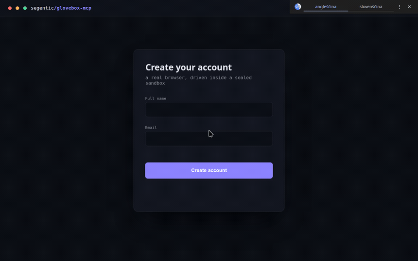

# glovebox-mcp

A **sandboxed computer-use MCP server** — let an AI agent drive a real browser and desktop apps
(mouse, keyboard, screenshots, vision grounding), confined to a **nested X11 window** so it can
never touch your real screen, files, or other apps.

Like a lab **glovebox**: the agent reaches in and manipulates real applications, sealed off from
everything else. Bring the sandbox up, log into whatever sites or apps you want to automate *inside
that window*, and the agent operates only there — you can watch it live and close it instantly.

> Speaks the [Model Context Protocol](https://modelcontextprotocol.io), so it works with MCP clients
> like Claude Code. Your host can run Wayland; the sandbox gives the agent a real X server to drive.



<sub>An agent driving a real browser in the sandbox — gliding the cursor, inserting a unicode name (`Nadja Kovačič`), typing, and submitting. All confined to a nested X11 window.</sub>

## Why a nested X11 sandbox?

- Most desktop automation (xdotool, PyAutoGUI) is **X11-only**, but many modern desktops run **Wayland**.
- **Xephyr** provides a real X server *inside a single window* (`DISPLAY :1`). Everything the agent
  does — clicks, typing, screenshots — is **confined to that window**, not your real desktop.
- You stay in control: watch it live, `pkill Xephyr` to close everything.

## Requirements

- **Linux** — the sandbox nests a real X server (Xephyr), so it works even on **Wayland** hosts
  (via Xwayland). Not macOS/Windows. Developed on Ubuntu; any modern Linux with the packages below.
- **Python 3.10+** and [`uv`](https://docs.astral.sh/uv/) (used for the virtualenv).
- **System packages** — `xserver-xephyr` (Xephyr), `openbox`, `scrot`, `x11-utils`, `xdotool`,
  `wmctrl`, `xclip` (+ `tesseract-ocr` for `basic`). On Debian/Ubuntu the installer **auto-installs**
  these via `apt` (sudo) when missing; on other distros it lists them and asks you to install first.
- A **browser** in the sandbox (Chromium or Chrome).
- **NVIDIA GPU (≥6 GB VRAM)** — only for the `local` vision mode.

## Install

Clone, then run the installer for the vision backend you want. It prints the one `sudo apt-get …`
line the X11 sandbox needs, then installs the Python deps for that mode:

```bash
git clone https://github.com/segentic-lab/glovebox-mcp && cd glovebox-mcp

./install.sh none      # no local models — your agent reads screenshots itself (lightest, instant)
./install.sh basic     # Tesseract OCR grounding — text + coordinates, CPU-only
./install.sh local     # OmniParser grounding on an NVIDIA GPU — text + icons (~4 GB weights)
```

- **none** — no local grounding model; the agent's own multimodal vision reads the screenshots.
- **basic** — Tesseract OCR: `parse_screen` returns text elements + coordinates (CPU-only).
- **local** — OmniParser on the GPU: `parse_screen` returns text **+ icons** with pixel-precise boxes.
  Best grounding; preflights CUDA + ≥6 GB VRAM and downloads ~4 GB of weights.

Your choice is written to `.vision-mode` (override per run with the `GLOVEBOX_VISION` env var).

### Works with any MCP client / harness

Claude Code, Cursor, Codex, or your own agent — it's a standard MCP server, not tied to any one host.
Two compatibility notes: **`basic`/`local`** return element **coordinates as text**, so they work even
with text-only agents; **`none`** relies on the client passing the tool's **screenshots** to a
multimodal model (fine for Claude Code, Cursor, and other image-capable MCP clients).

## Quickstart

1. **Start the sandbox** (leave it running):
   ```bash
   ./start-display.sh              # 1440×900 Xephyr window with a browser
   ./start-display.sh 1920x1080    # …or pass a screen size (or set $RES)
   ```
   Log into any sites or apps you want to automate **in that window**.
2. **Register the server** with your MCP client. `install.sh` already wrote **`mcp-config.json`** with
   your real install path — copy its `glovebox` block into your client's MCP config:
   ```jsonc
   { "mcpServers": { "glovebox": {
       "command": "/abs/path/to/glovebox-mcp/.venv/bin/python",   // filled in by install.sh
       "args":    ["/abs/path/to/glovebox-mcp/server.py"],
       "env":     { "DISPLAY": ":1" }
   } } }
   ```
   Restart the client so it loads the server.
3. Ask the agent to screenshot / click / type — it operates **only** on the `:1` window.

> **Driving it with an AI agent?** Paste [`AGENTS.md`](AGENTS.md) into the agent's system prompt — it
> teaches the observe → act → verify loop, grounding, the upload/unicode gotchas, and when to stop.

## Tools

| Tool | What |
|---|---|
| `parse_screen()` | Vision grounding → JSON of every element (id, type, label, interactive, pixel-center) + a numbered Set-of-Mark image at `/tmp/glovebox_annotated.png`. (`local` mode: OmniParser on GPU, ~2 s.) |
| `click_element(id)` | Click an element from the last `parse_screen` (no coordinate guessing). |
| `screenshot()` | Screenshot of an instance. |
| `click(x,y)` · `move_mouse` · `scroll` · `drag` · `double_click` | Pointer ops. |
| `type_text(text)` | **Unicode-safe** typing (ASCII via xdotool; anything with č/š/ž… is inserted via the clipboard, because xdotool's synthetic unicode is silently dropped by some GTK apps). |
| `press_keys("ctrl+a"/"Return"/…)` | Keys/combos (xdotool syntax). |
| `upload_file(filepath, selector?)` | Attach a local file to a page's `<input type=file>` via the **Chrome DevTools Protocol**. The nested X11 file picker is invisible to automation **and hangs the renderer**, so use this for all uploads — never click an upload button expecting a dialog. Works on Chromium started by `launch_app`/`start-display.sh` (they open a per-instance `--remote-debugging-port`, `9222+N`). **Browser file inputs only** — for native apps see `open_file`. |
| `open_file(filepath, app?)` | Open a local file in a **native** app on the instance's display (e.g. `app="gimp"`) or via `xdg-open`. GTK apps get the same X11/D-Bus handling as `launch_app`. |
| `list_files()` | The instance's staging folder `files/<N>/` (under the install dir) + its contents. |
| `launch_app(command, name?, size?)` · `list_instances()` · `close_instance(n)` | Multi-instance control (see below). |
| `wait_ms(ms)` · `get_screen_size()` | Timing / sandbox size. |

Every control tool takes **`instance=N`** and optional **`observe`** / **`settle_ms`** (see below).
In `local` mode OmniParser is **lazy-loaded** on first `parse_screen` (~6 s once, then ~2 s/parse).

### Vision backend (selectable)

`GLOVEBOX_VISION` env var, or the `.vision-mode` file, or default `local`:

| Mode | `parse_screen` | Needs | When |
|---|---|---|---|
| `none` | disabled (returns a note) — use `screenshot()` + reason | nothing (mcp, mss, xdotool) | lightest; let the agent's own vision do grounding |
| `basic` | Tesseract OCR → text elements + coords | `tesseract-ocr` + `pytesseract` | no GPU; text-only grounding |
| `local` | OmniParser → text **+ icons** + coords | torch + CUDA + OmniParser weights | best grounding |

Switch anytime with `./install.sh <mode>` (installs only what that mode needs).

### Multi-instance (a fleet of app windows)

Every control tool takes **`instance=N`** (default 1 = the `start-display.sh` sandbox). Spin up more —
each its own Xephyr display/window on the host desktop:

- `launch_app(command, name?, size?)` → starts the next free `:N` running **any** GUI app
  (`chromium`, `gimp`, `inkscape`, `xterm`, …). Chromium auto-gets X11 flags, a per-instance profile,
  a remote-debugging port, and D-Bus isolation. Returns the instance id.
- `list_instances()` · `close_instance(n)`.

Because each display has its **own cursor**, multiple agents can drive different instances **in parallel** —
one window each. The only shared resource is the GPU for `local`-mode `parse_screen` (it just queues).
The host display for new windows is `GLOVEBOX_HOST_DISPLAY` (default `:0`); `XAUTHORITY` is auto-discovered.

### One-call action + observe

`click` · `click_element` · `type_text` · `press_keys` · `scroll` · `drag` · `double_click` take
**`observe`** (`none` default · `screenshot` · `parse`) and **`settle_ms`**. With `observe="screenshot"`
the action returns its result **and** the resulting screen in a single call (with `settle_ms` to let the
page update first) — no separate screenshot round-trip. Default `none` keeps routine steps cheap; opt
into `screenshot`/`parse` on the steps that change the page (navigations, submits).

### Files & uploads

Each instance gets a staging folder **`files/<N>/`** inside the install dir — a stable place to drop
files for that instance (readable by native apps and, since it's under `$HOME`, by snap Chromium too).
`list_files(instance)` shows the folder and its contents.

- **Browser** `<input type=file>` → **`upload_file(path, instance)`** (via CDP). The nested file
  picker is invisible to automation and hangs snap Chromium, so never click an upload button expecting
  a dialog.
- **Native apps** (GIMP, Inkscape, editors) → **`open_file(path, instance, app="gimp")`**, or just
  drive the app's own **Open dialog** — unlike the browser's, it's a real visible window you can type a
  path into (`Ctrl+L` in a GTK file chooser).
- **Saving / downloads** → apps run as your user, so they can save anywhere you can write. `launch_app`
  Chromium instances are pre-configured to **download and "save as" into `files/<N>/`**; point native
  apps' Save dialogs there too, then `list_files(instance)` to see the results.

## Maintenance (`local` mode)

`install.sh` clones [OmniParser](https://github.com/microsoft/OmniParser), downloads the v2 weights, and
applies two patches automatically:

- **PaddleOCR made optional** (this uses easyocr): `OmniParser/util/utils.py`'s
  `from paddleocr import PaddleOCR` is wrapped in try/except and the module-level `paddle_ocr = PaddleOCR(...)`
  is guarded with `… if PaddleOCR is not None else None`.
- **`transformers` is pinned to 4.49.0** — newer releases break Florence-2's remote config.

If you upgrade OmniParser manually, re-apply the PaddleOCR patch. Weights live in `OmniParser/weights/`.

## Stop

```bash
pkill Xephyr      # closes the sandbox (browser + WM + display)
```

## Safety

- The agent's input and vision are **scoped to the sandbox display** — it does not see or control your real desktop.
- The server process runs as your user (shell/file access, like any MCP server); only its **GUI control** is
  sandboxed to the Xephyr window. For OS-level isolation from your files, run it inside a VM or container.
- You can watch everything live and close it instantly with `pkill Xephyr`.
- Automate responsibly — only sites and services you are authorized to use.

## Files

- `server.py` — the MCP server (all tools).
- `install.sh` — mode-aware installer (`none` / `basic` / `local`).
- `start-display.sh` — launches the Xephyr sandbox (display + window manager + browser).
- `AGENTS.md` — drop-in tool-usage instructions for the AI agent (paste into its system prompt).
- `mcp-config.json` — a ready-to-paste MCP client config snippet.

## Credits

`local` vision mode uses Microsoft's [OmniParser](https://github.com/microsoft/OmniParser)
(cloned and weights downloaded by `install.sh`, under its own license). Screen capture uses
[mss](https://github.com/BoboTiG/python-mss); input is driven with
[xdotool](https://github.com/jordansissel/xdotool). Not affiliated with Microsoft.

## Contributing

Shipped **as-is** under MIT. Issues and PRs are welcome, but this is maintained by one person —
**no support or response time is guaranteed.** If it's useful to you, a ⭐ helps.

## License

MIT — see [LICENSE](LICENSE).
